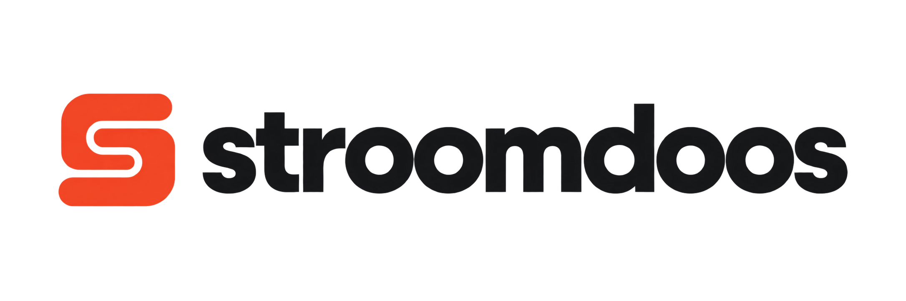
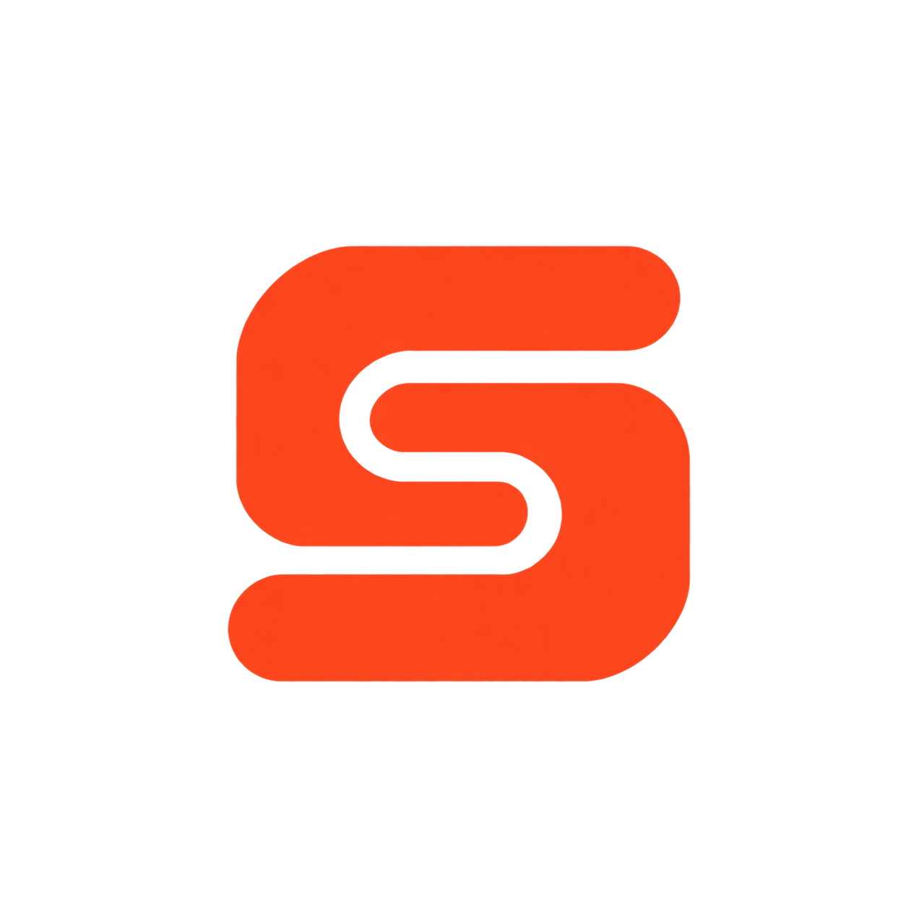

# Stroomdoos — gekozen merkassets

Overdracht voor Claude, 31 oktober 2026. **Stroomdoos is de ontwikkelaar; MixPrep is de app.**
Luc heeft het oorspronkelijke S-woordmerk behouden en de oranje stekkerdoos als zelfstandig beeldmerk gekozen.

## Bestanden

| Bestand | Gebruik | Achtergrond |
| --- | --- | --- |
| [stroomdoos-wordmark-s-dark.png](stroomdoos-wordmark-s-dark.png) | Primair horizontaal logo met S en `stroomdoos`; bijvoorbeeld websiteheader | Transparant, donkere tekst; gebruik op licht |
| [stroomdoos-symbol-s-orange.png](stroomdoos-symbol-s-orange.png) | Losse S als compact alternatief | Transparant |
| [stroomdoos-symbol-powerstrip.png](stroomdoos-symbol-powerstrip.png) | Oranje stekkerdoos als zelfstandig merkbeeld | Transparant |
| [stroomdoos-icon-powerstrip-light.png](stroomdoos-icon-powerstrip-light.png) | Vierkante icooncompositie; basis voor platformexports | Gebroken wit |

### Primair woordmerk

### Losse beeldmerken en vierkant icoon

## Gebruiksafspraken voor Claude

- Gebruik per toepassing één beeldmerk. Zet niet de S én de stekkerdoos naast het woordmerk.
- Primair logo: S + `stroomdoos`. Stekkerdoos: zelfstandig icoon/beeldmerk. De losse S is een alternatief als weinig ruimte beschikbaar is.
- Behoud beeldverhoudingen en vrije ruimte; niet uitrekken. De PNG-masters hebben ingebouwde marge.
- Donkere tekst en het donkere snoer hebben een lichte achtergrond nodig. Deze set bevat geen goedgekeurde witte woordmerkvariant voor donkere achtergronden.
- Richtkleuren: oranje `#F04A2D`, bijna-zwart `#17191C`, gebroken wit `#F1F0EA`. Dit zijn de ontwerpkleuren; gegenereerde PNG's kunnen kleine kleurvariaties bevatten.
- Dit zijn gerasterde PNG-assets, geen SVG-masters, geen meegeleverd lettertype en geen geïnstalleerd Dock-icoon. Geometrische vectoruitwerking en favicon/ICNS-exports zijn aparte vervolgstappen; beoordeel daarbij scherpe randen, consistente verhoudingen en herkenbaarheid op 16/32/64 px.
- De losse S is een gegenereerde afleiding van het oorspronkelijke woordmerk, geen pixel-exacte uitsnede. Gebruik bij een latere vectoruitwerking één gedeelde geometrie voor woordmerk en losse S.
- De Stroomdoos-assets veranderen niet automatisch de MixPrep-productidentiteit. Vervang geen MixPrep-appicoon of appnaam als onderdeel van deze overdracht.

## Status van deze overdracht

Alleen assets en documentatie toegevoegd. De websiteheader, favicon, screenshots en app zijn niet aangepast. De branch kan door Claude worden opgehaald; toepassing op de website volgt als aparte wijziging.

`manifest.json` bevat afmetingen, PNG-kleurtype en SHA-256 per bestand. De beelden zijn gemaakt met de ingebouwde image_gen-tool. Zie [GENERATION.md](GENERATION.md) voor de gebruikte prompts en herkomst. Niet-gekozen varianten en persoonlijke bronbestanden zijn niet opgenomen.
